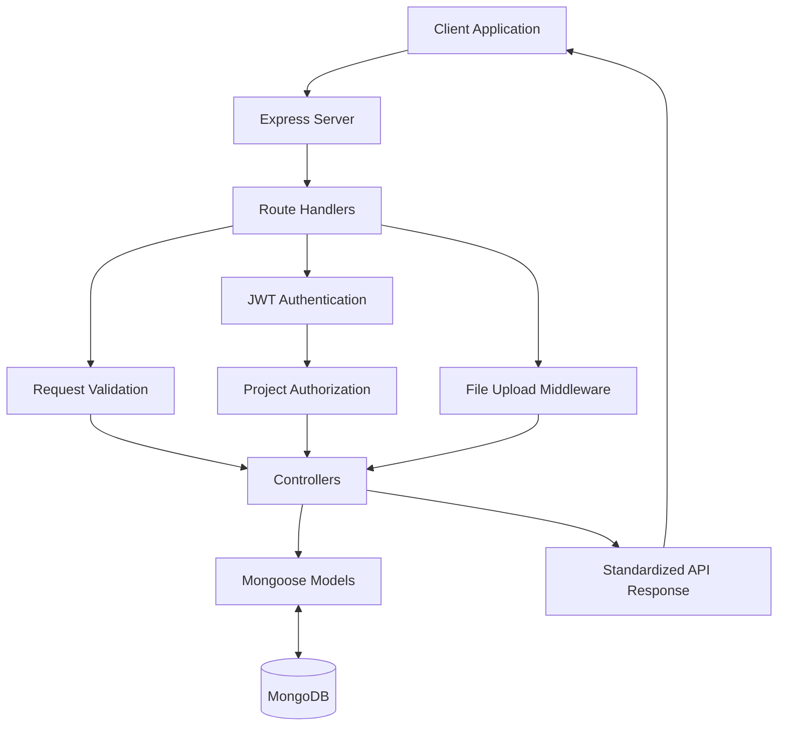
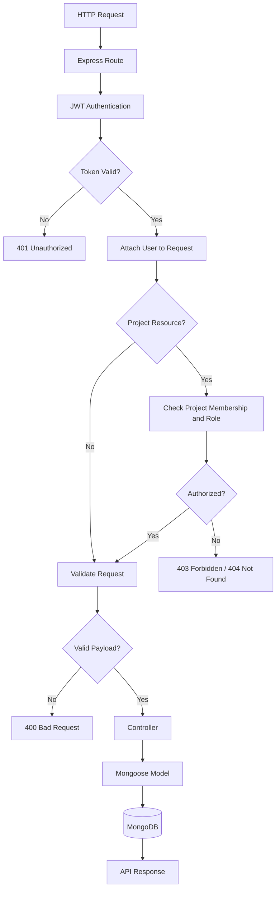
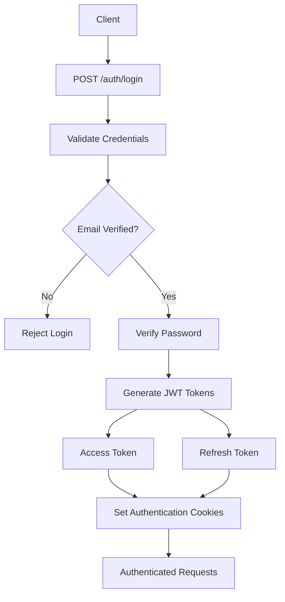
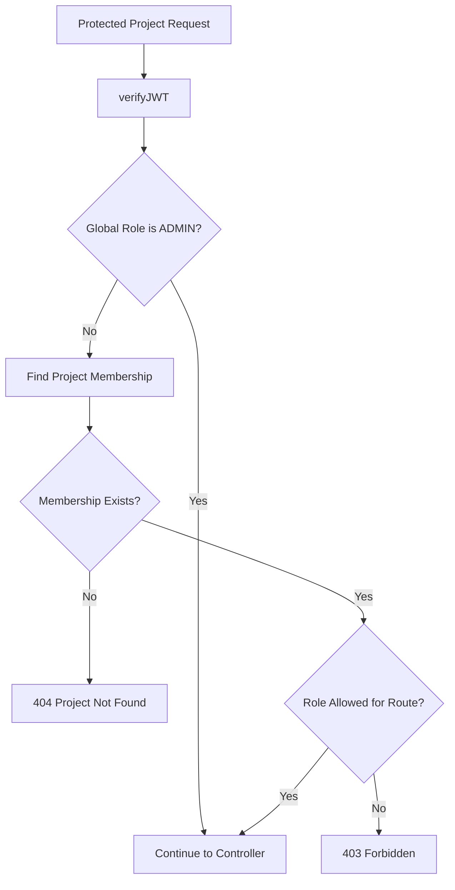
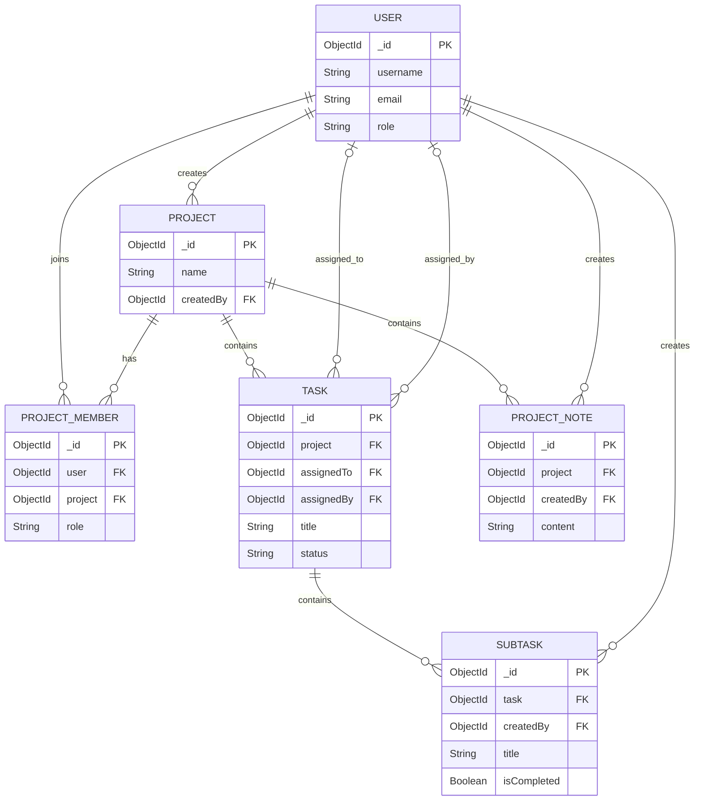

# 🚀 Project Camp Backend

A powerful RESTful backend API for a collaborative project management platform, built using **Node.js, Express.js, MongoDB, and Mongoose**.

Project Camp provides a structured environment for managing projects, collaborating with team members, organizing tasks and subtasks, sharing project notes, and controlling access through role-based authorization.

The backend includes secure user authentication, JWT access and refresh tokens, email verification, password recovery, project membership management, task assignments, file attachments, and project-level permissions.

---

## 📌 Table of Contents

- [Overview](#-overview)
- [Features](#-features)
- [Technology Stack](#-technology-stack)
- [System Architecture](#-system-architecture)
- [Project Structure](#-project-structure)
- [Getting Started](#-getting-started)
- [Environment Variables](#-environment-variables)
- [Running the Application](#️-running-the-application)
- [API Documentation](#-api-documentation)
  - [Base URL](#base-url)
  - [Health Check](#1-health-check)
  - [Authentication APIs](#2-authentication-apis)
  - [Project APIs](#3-project-apis)
  - [Project Member APIs](#4-project-member-apis)
  - [Task APIs](#5-task-apis)
  - [Subtask APIs](#6-subtask-apis)
  - [Project Notes APIs](#7-project-notes-apis)
- [Authentication and Authorization](#-authentication-and-authorization)
- [Role-Based Access Control](#-role-based-access-control)
- [Database Models](#-database-models)
- [File Uploads](#-file-uploads)
- [Error Handling](#️-error-handling)
- [CORS Configuration](#-cors-configuration)
- [Development Commands](#-development-commands)
- [Security Considerations](#-security-considerations)
- [Future Improvements](#-future-improvements)
- [Contributing](#-contributing)
- [License](#-license)
- [Author](#-author)

---

## 📖 Overview

**Project Camp Backend** is the server-side application of a collaborative project management system.

It is designed to help teams organize their work through projects, team members, tasks, subtasks, and project notes.

The application follows a modular architecture in which routes, controllers, middleware, models, validators, and utility functions are maintained separately.

The backend is responsible for:

- Managing user registration and authentication.
- Verifying user email addresses.
- Generating and refreshing JWT tokens.
- Creating and managing projects.
- Managing project members and their roles.
- Creating and assigning tasks.
- Tracking task completion through status updates.
- Organizing tasks into subtasks.
- Managing collaborative project notes.
- Handling task attachments.
- Enforcing authentication and authorization rules.

### Current Implementation Status

The following modules are implemented in the current codebase:

| Module                        | Status                 |
| ----------------------------- | ---------------------- |
| Express server configuration  | Implemented            |
| MongoDB integration           | Implemented            |
| User registration and login   | Implemented            |
| Email verification            | Implemented            |
| JWT authentication            | Implemented            |
| Refresh token rotation        | Implemented            |
| Password management           | Implemented            |
| Project management            | Implemented            |
| Project member management     | Implemented            |
| Role-based authorization      | Implemented            |
| Task management               | Implemented            |
| Subtask management            | Implemented            |
| Project notes management      | Implemented            |
| Task file attachments         | Implemented            |
| Automated test suite          | Not currently included |
| Swagger/OpenAPI documentation | Not currently included |

---

## ✨ Features

### 1. Authentication and User Management

Project Camp implements a JWT-based authentication system with access and refresh tokens.

Features include:

- User registration.
- Unique username and email validation.
- Password hashing using bcrypt.
- Email verification through verification links.
- Secure user login.
- JWT access token generation.
- JWT refresh token generation.
- Refresh token validation and rotation.
- HTTP-only authentication cookies.
- Bearer token authentication.
- Fetch authenticated user information.
- User logout.
- Change password.
- Forgot password functionality.
- Password reset through temporary tokens.
- Resend email verification.

### 2. Project Management

Authenticated users with the appropriate permissions can manage projects.

Features include:

- Create new projects.
- Retrieve projects accessible to the current user.
- Retrieve individual project details.
- Update project information.
- Delete projects.
- Automatically assign the creator as the project's administrator.
- Retrieve project member information.
- Calculate project member counts.

### 3. Project Member Management

The application maintains a separate membership collection to associate users with projects.

Features include:

- Add existing registered users to projects using their email addresses.
- Retrieve all project members.
- Assign project-level roles.
- Update member roles.
- Remove project members.
- Prevent duplicate project memberships.
- Enforce role-based member management permissions.

### 4. Task Management

Tasks represent individual units of work within a project.

Features include:

- Create tasks.
- Retrieve all tasks belonging to a project.
- Retrieve individual task details.
- Update task information.
- Assign tasks to project members.
- Update task status.
- Delete tasks.
- Upload multiple attachments.
- Remove existing attachments.
- Retrieve assigned-user information.

Supported task statuses:

| Status        | Description                        |
| ------------- | ---------------------------------- |
| `todo`        | Task has not been started.         |
| `in_progress` | Task is currently being worked on. |
| `done`        | Task has been completed.           |

### 5. Subtask Management

Subtasks provide a way to divide larger tasks into smaller actionable items.

Features include:

- Create subtasks under existing tasks.
- Retrieve subtasks through task details.
- Update subtask information.
- Mark subtasks as completed.
- Allow project members to update completion status.
- Delete subtasks.
- Associate each subtask with its creator and parent task.

### 6. Project Notes

Project notes provide a shared space for storing important project-related information.

Features include:

- Create project notes.
- Retrieve all notes belonging to a project.
- Retrieve individual notes.
- Update notes.
- Delete notes.
- Associate notes with their creators.
- Enforce note ownership permissions.

### 7. File Management

Task attachments are handled using Multer.

Features include:

- Multiple attachments per task.
- Local file storage.
- Unique filenames generated using UUID.
- Attachment metadata storage.
- Attachment URL generation.
- MIME type metadata.
- File size metadata.
- Attachment removal during task updates.

---

## 🛠 Technology Stack

The project uses the following technologies and libraries:

| Technology            | Purpose                          |
| --------------------- | -------------------------------- |
| Node.js               | JavaScript runtime               |
| Express.js 5          | Backend web framework            |
| MongoDB               | NoSQL database                   |
| Mongoose              | MongoDB object modeling          |
| JavaScript ES Modules | Module management                |
| JSON Web Token        | Authentication and authorization |
| bcrypt                | Password hashing                 |
| express-validator     | Request validation               |
| Nodemailer            | Email delivery                   |
| Mailgen               | Email template generation        |
| Multer                | File upload handling             |
| cookie-parser         | Cookie parsing                   |
| CORS                  | Cross-origin resource sharing    |
| dotenv                | Environment variable management  |
| Nodemon               | Development server               |
| Prettier              | Code formatting                  |

---

## 🏗 System Architecture

Project Camp follows a modular, controller-based Express architecture.

Each module has a specific responsibility, making the application easier to maintain, extend, and debug.

### High-Level Architecture



### Request Lifecycle

A typical protected API request follows this sequence:

1. The client sends an HTTP request.
2. Express identifies the matching route.
3. Authentication middleware verifies the JWT.
4. The authenticated user is attached to the request.
5. Project permission middleware checks membership and role where required.
6. Request validation middleware validates applicable request data.
7. The controller executes the business logic.
8. Mongoose communicates with MongoDB.
9. The controller returns a standardized API response.



### Authentication Flow



---

## 📁 Project Structure

The repository follows a modular directory structure:

text

```
project-camp-backend/
│
├── public/
│   ├── images/
│   └── uploads/
│
├── src/
│   │
│   ├── controllers/
│   │   ├── auth.controllers.js
│   │   ├── healthcheck.controllers.js
│   │   ├── project.controllers.js
│   │   ├── task.controllers.js
│   │   └── note.controllers.js
│   │
│   ├── db/
│   │   └── index.js
│   │
│   ├── middlewares/
│   │   ├── auth.middlewares.js
│   │   ├── multer.middlewares.js
│   │   └── validator.middlewares.js
│   │
│   ├── models/
│   │   ├── user.models.js
│   │   ├── project.models.js
│   │   ├── projectmember.models.js
│   │   ├── task.models.js
│   │   ├── subtask.models.js
│   │   └── note.models.js
│   │
│   ├── routes/
│   │   ├── auth.routes.js
│   │   ├── healthcheck.routes.js
│   │   ├── project.routes.js
│   │   ├── task.routes.js
│   │   └── note.routes.js
│   │
│   ├── utils/
│   │   ├── api-error.js
│   │   ├── api-response.js
│   │   ├── async-handler.js
│   │   ├── constants.js
│   │   └── mail.js
│   │
│   ├── validators/
│   │   └── index.js
│   │
│   ├── app.js
│   └── index.js
│
├── .env.example
├── .gitignore
├── .prettierignore
├── .prettierrc
├── PRD.md
├── package.json
├── package-lock.json
└── README.md

```

### Directory Responsibilities

**`controllers/`**

Contains the application's business logic.

Controllers process requests, communicate with database models, and return API responses.

**`db/`**

Contains the MongoDB connection configuration using Mongoose.

**`middlewares/`**

Contains reusable middleware responsible for:

- JWT authentication.
- Project-level authorization.
- Request validation.
- File upload handling.

**`models/`**

Contains Mongoose schemas and database models.

**`routes/`**

Defines the API endpoints and associates them with the appropriate controllers and middleware.

**`utils/`**

Contains reusable application utilities, including:

- API error handling.
- Standardized API responses.
- Async handler.
- Application constants.
- Email utilities.

**`validators/`**

Contains reusable request validation rules using express-validator.

**`app.js`**

Configures Express, JSON parsing, CORS, cookies, static file serving, and API route registration.

**`index.js`**

Loads environment variables, establishes the database connection, and starts the HTTP server.

---

## 🚀 Getting Started

Follow these instructions to run Project Camp Backend locally.

### Prerequisites

Make sure the following software is installed:

- Node.js
- npm
- MongoDB Community Server or MongoDB Atlas.
- Git.
- A Mailtrap account or another compatible SMTP provider.

### 1. Clone the Repository

bash

```
git clone https://github.com/Ayush16110/project-camp-backend.git

```

Navigate into the project directory:

bash

```
cd project-camp-backend

```

### 2. Install Dependencies

Install all project dependencies:

bash

```
npm install

```

### 3. Configure Environment Variables

Create a `.env` file in the root directory.

You can use the existing environment template:

bash

```
cp .env.example .env

```

On Windows PowerShell:

powershell

```
Copy-Item .env.example .env

```

Open `.env` and configure the required values.

Refer to the Environment Variables section below.

### 4. Configure MongoDB

Make sure MongoDB is running locally or configure a MongoDB Atlas connection string.

Example local MongoDB URI:

env

```
MONGO_URI=mongodb://127.0.0.1:27017/project-camp

```

For MongoDB Atlas:

env

```
MONGO_URI=mongodb+srv://<username>:<password>@<cluster-url>/project-camp

```

Replace the placeholders with your actual database credentials.

**Note:** Project deletion uses MongoDB transactions to remove associated project data. Use a MongoDB deployment that supports transactions, such as a replica set or sharded cluster.

### 5. Configure Email Service

The backend uses Nodemailer and Mailgen for sending transactional emails.

Configure the SMTP credentials in your `.env` file.

These credentials are required for:

- Email verification.
- Password reset emails.
- Verification email resending.

### 6. Start the Development Server

Run:

bash

```
npm run dev

```

The development server uses Nodemon to restart automatically when source files change.

### 7. Verify the Server

Once the server has started, open:

text

```
http://localhost:8000/api/v1/healthcheck

```

A successful response confirms that the API is responding.

---

## 🔐 Environment Variables

The application uses dotenv to load environment variables.

The following variables are defined in `.env.example`:

| Variable                       | Description                                                 |
| ------------------------------ | ----------------------------------------------------------- |
| `PORT`                         | Port on which the Express server runs.                      |
| `MONGO_URI`                    | MongoDB connection string.                                  |
| `CORS_ORIGIN`                  | Allowed frontend origin or comma-separated origins.         |
| `NODE_ENV`                     | Application environment, such as development or production. |
| `ACCESS_TOKEN_SECRET`          | Secret used to sign access tokens.                          |
| `ACCESS_TOKEN_EXPIRY`          | Access token expiration duration.                           |
| `REFRESH_TOKEN_SECRET`         | Secret used to sign refresh tokens.                         |
| `REFRESH_TOKEN_EXPIRY`         | Refresh token expiration duration.                          |
| `MAILTRAP_SMTP_HOST`           | SMTP server hostname.                                       |
| `MAILTRAP_SMTP_PORT`           | SMTP server port.                                           |
| `MAILTRAP_SMTP_USER`           | SMTP authentication username.                               |
| `MAILTRAP_SMTP_PASS`           | SMTP authentication password.                               |
| `FORGOT_PASSWORD_REDIRECT_URL` | Frontend password reset URL.                                |
| `SERVER_URL`                   | Public backend URL used to generate attachment URLs.        |

### Example Configuration

env

```
# Server Configuration
PORT=8000
NODE_ENV=development

# Database
MONGO_URI=mongodb://127.0.0.1:27017/project-camp

# CORS
CORS_ORIGIN=http://localhost:5173

# JWT Configuration
ACCESS_TOKEN_SECRET=your_access_token_secret
ACCESS_TOKEN_EXPIRY=15m

REFRESH_TOKEN_SECRET=your_refresh_token_secret
REFRESH_TOKEN_EXPIRY=7d

# SMTP Configuration
MAILTRAP_SMTP_HOST=your_smtp_host
MAILTRAP_SMTP_PORT=your_smtp_port
MAILTRAP_SMTP_USER=your_smtp_username
MAILTRAP_SMTP_PASS=your_smtp_password

# Password Reset
FORGOT_PASSWORD_REDIRECT_URL=http://localhost:5173/reset-password

# Backend Public URL
SERVER_URL=http://localhost:8000

```

**Important:**

- Replace all placeholder credentials with real values.
- Use strong, unique JWT secrets.
- Never commit your `.env` file.
- Keep SMTP credentials private.
- Configure the production frontend origin before deployment.
- Set `SERVER_URL` to the publicly accessible backend URL in production.

---

## ▶️ Running the Application

### Development Mode

bash

```
npm run dev

```

Starts the application using Nodemon.

### Production Mode

bash

```
npm start

```

Starts the application using Node.js.

### Code Formatting

Format the project using Prettier:

bash

```
npm run format

```

Check formatting without modifying files:

bash

```
npm run format:check

```

---

# 📡 API Documentation

## Base URL

All API endpoints are prefixed with:

text

```
http://localhost:8000/api/v1

```

The port can be changed through the `PORT` environment variable.

### Authentication Types

| Type             | Description                                                  |
| ---------------- | ------------------------------------------------------------ |
| Public           | Endpoint does not require authentication.                    |
| Protected        | Requires a valid access token.                               |
| Protected + Role | Requires authentication and appropriate project permissions. |

Protected endpoints accept access tokens through either:

**HTTP-only Cookie**

text

```
accessToken=<your_access_token>

```

**Authorization Header**

http

```
Authorization: Bearer <your_access_token>

```

---

## 1. Health Check

Used to verify that the backend API is running.

| Method | Endpoint        | Access |
| ------ | --------------- | ------ |
| GET    | `/healthcheck/` | Public |

Example:

http

```
GET /api/v1/healthcheck/

```

---

## 2. Authentication APIs

Base route:

text

```
/api/v1/auth

```

| Method | Endpoint                           | Access    | Description                             |
| ------ | ---------------------------------- | --------- | --------------------------------------- |
| POST   | `/register`                        | Public    | Register a new user.                    |
| POST   | `/login`                           | Public    | Authenticate a user.                    |
| GET    | `/verify-email/:verificationToken` | Public    | Verify email address.                   |
| POST   | `/refresh-token`                   | Public    | Generate new access and refresh tokens. |
| POST   | `/forgot-password`                 | Public    | Request password reset.                 |
| POST   | `/reset-password/:resetToken`      | Public    | Reset forgotten password.               |
| POST   | `/logout`                          | Protected | Log out the current user.               |
| POST   | `/current-user`                    | Protected | Retrieve authenticated user.            |
| POST   | `/change-password`                 | Protected | Change current password.                |
| POST   | `/resend-email-verification`       | Protected | Resend verification email.              |

### User Registration

http

```
POST /api/v1/auth/register
Content-Type: application/json

```

Registers a new user and sends an email verification link.

### User Login

http

```
POST /api/v1/auth/login
Content-Type: application/json

```

Authenticates a verified user and generates JWT tokens.

The response includes user information and tokens, while authentication cookies are also set.

### Email Verification

http

```
GET /api/v1/auth/verify-email/:verificationToken

```

Verifies the user's email using the temporary verification token.

### Refresh Access Token

http

```
POST /api/v1/auth/refresh-token

```

Validates the refresh token and generates a new access token and refresh token.

The refresh token can be provided through a cookie or the request body.

### Forgot Password

http

```
POST /api/v1/auth/forgot-password
Content-Type: application/json

```

Initiates the password recovery process by sending a reset link to the registered email address.

### Reset Password

http

```
POST /api/v1/auth/reset-password/:resetToken
Content-Type: application/json

```

Allows users to reset their password using a valid reset token.

### Get Current User

http

```
POST /api/v1/auth/current-user

```

Returns information about the authenticated user.

### Change Password

http

```
POST /api/v1/auth/change-password
Content-Type: application/json

```

Allows an authenticated user to change their password after validating the existing password.

---

## 3. Project APIs

Base route:

text

```
/api/v1/projects

```

| Method | Endpoint      | Access         | Description                   |
| ------ | ------------- | -------------- | ----------------------------- |
| GET    | `/`           | Protected      | Retrieve accessible projects. |
| POST   | `/`           | Global Admin   | Create a project.             |
| GET    | `/:projectId` | Project Member | Retrieve project details.     |
| PUT    | `/:projectId` | Project Admin  | Update project details.       |
| DELETE | `/:projectId` | Global Admin   | Delete a project.             |

### Create Project

http

```
POST /api/v1/projects/
Content-Type: application/json

```

Creates a new project.

The creator is automatically assigned the `project_admin` membership role.

### Get Projects

http

```
GET /api/v1/projects/

```

Retrieves the projects available to the authenticated user.

The response includes project information and member counts.

### Get Project Details

http

```
GET /api/v1/projects/:projectId

```

Returns the details of a specific project.

### Update Project

http

```
PUT /api/v1/projects/:projectId
Content-Type: application/json

```

Updates project information.

### Delete Project

http

```
DELETE /api/v1/projects/:projectId

```

Deletes a project and its associated project memberships, tasks, and subtasks within a database transaction.

---

## 4. Project Member APIs

Base route:

text

```
/api/v1/projects

```

| Method | Endpoint                      | Access         | Description               |
| ------ | ----------------------------- | -------------- | ------------------------- |
| GET    | `/:projectId/members`         | Project Member | Retrieve project members. |
| POST   | `/:projectId/members`         | Project Admin  | Add a member.             |
| PUT    | `/:projectId/members/:userId` | Project Admin  | Update member role.       |
| DELETE | `/:projectId/members/:userId` | Project Admin  | Remove a member.          |

### Add Project Member

http

```
POST /api/v1/projects/:projectId/members
Content-Type: application/json

```

Adds an existing registered user to a project using their email address and assigned role.

### Get Project Members

http

```
GET /api/v1/projects/:projectId/members

```

Returns the members associated with a project, including their user information and membership roles.

### Update Member Role

http

```
PUT /api/v1/projects/:projectId/members/:userId
Content-Type: application/json

```

Updates a member's project-level role.

Available membership roles:

- `project_admin`
- `member`

The implementation restricts assignment or modification of the `project_admin` role to global administrators.

### Remove Project Member

http

```
DELETE /api/v1/projects/:projectId/members/:userId

```

Removes an existing project membership.

---

## 5. Task APIs

Base route:

text

```
/api/v1/tasks

```

| Method | Endpoint                | Access         | Description             |
| ------ | ----------------------- | -------------- | ----------------------- |
| GET    | `/:projectId`           | Project Member | Retrieve project tasks. |
| POST   | `/:projectId`           | Project Admin  | Create a task.          |
| GET    | `/:projectId/t/:taskId` | Project Member | Retrieve task details.  |
| PUT    | `/:projectId/t/:taskId` | Project Admin  | Update a task.          |
| DELETE | `/:projectId/t/:taskId` | Project Admin  | Delete a task.          |

### Create Task

http

```
POST /api/v1/tasks/:projectId
Content-Type: multipart/form-data

```

Creates a task inside a project.

Supports:

- Task title.
- Task description.
- Assigned user.
- Task status.
- Multiple attachments.

The `attachments` field is used for uploading task files.

If no assignee is provided, the authenticated user is assigned by default.

### Get All Tasks

http

```
GET /api/v1/tasks/:projectId

```

Retrieves all tasks associated with the specified project.

Assigned user information is populated in the response.

### Get Task Details

http

```
GET /api/v1/tasks/:projectId/t/:taskId

```

Retrieves an individual task, including:

- Task information.
- Assigned user details.
- Associated subtasks.
- Subtask creator information.

### Update Task

http

```
PUT /api/v1/tasks/:projectId/t/:taskId
Content-Type: multipart/form-data

```

Updates an existing task.

Supported operations include:

- Updating title.
- Updating description.
- Changing assigned user.
- Updating task status.
- Adding attachments.
- Removing existing attachments.

The `removeAttachments` field accepts a JSON-encoded array of attachment URLs.

### Delete Task

http

```
DELETE /api/v1/tasks/:projectId/t/:taskId

```

Deletes the specified task and its associated subtasks.

---

## 6. Subtask APIs

Subtasks are nested under tasks for creation but are updated and deleted through their own identifiers.

| Method | Endpoint                         | Access         | Description       |
| ------ | -------------------------------- | -------------- | ----------------- |
| POST   | `/:projectId/t/:taskId/subtasks` | Project Admin  | Create a subtask. |
| PUT    | `/:projectId/st/:subTaskId`      | Project Member | Update a subtask. |
| DELETE | `/:projectId/st/:subTaskId`      | Project Admin  | Delete a subtask. |

### Create Subtask

http

```
POST /api/v1/tasks/:projectId/t/:taskId/subtasks
Content-Type: application/json

```

Creates a subtask associated with the specified parent task.

### Update Subtask

http

```
PUT /api/v1/tasks/:projectId/st/:subTaskId
Content-Type: application/json

```

Updates subtask information.

Project administrators can update subtask details and completion status.

Regular members can update only the completion status.

### Delete Subtask

http

```
DELETE /api/v1/tasks/:projectId/st/:subTaskId

```

Deletes the specified subtask.

---

## 7. Project Notes APIs

Base route:

text

```
/api/v1/notes

```

| Method | Endpoint                | Access         | Description             |
| ------ | ----------------------- | -------------- | ----------------------- |
| GET    | `/:projectId`           | Project Member | Retrieve project notes. |
| POST   | `/:projectId`           | Project Member | Create a note.          |
| GET    | `/:projectId/n/:noteId` | Project Member | Retrieve a note.        |
| PUT    | `/:projectId/n/:noteId` | Project Member | Update a note.          |
| DELETE | `/:projectId/n/:noteId` | Project Member | Delete a note.          |

### Create Note

http

```
POST /api/v1/notes/:projectId
Content-Type: application/json

```

Creates a new note inside the specified project.

The authenticated user is automatically recorded as the note creator.

### Get Project Notes

http

```
GET /api/v1/notes/:projectId

```

Retrieves all notes belonging to a project.

Creator information is populated in the response.

### Get Note Details

http

```
GET /api/v1/notes/:projectId/n/:noteId

```

Retrieves an individual project note.

### Update Note

http

```
PUT /api/v1/notes/:projectId/n/:noteId
Content-Type: application/json

```

Updates an existing note.

Project administrators and global administrators can modify notes. Regular members can modify only notes they created.

### Delete Note

http

```
DELETE /api/v1/notes/:projectId/n/:noteId

```

Deletes a note subject to the same ownership and administrative permissions.

---

# 🔑 Authentication and Authorization

Project Camp uses JSON Web Tokens (JWT) to secure protected API endpoints.

The authentication system uses two types of tokens.

### Access Token

The access token is used to authenticate requests to protected endpoints.

It is generated using:

env

```
ACCESS_TOKEN_SECRET=
ACCESS_TOKEN_EXPIRY=

```

The authentication middleware retrieves the token from:

1. The `accessToken` cookie.
2. The `Authorization` header using Bearer authentication.

### Refresh Token

The refresh token is used to generate new access tokens without requiring the user to log in again.

It is generated using:

env

```
REFRESH_TOKEN_SECRET=
REFRESH_TOKEN_EXPIRY=

```

The application stores the current refresh token in the user document and validates incoming refresh tokens against it.

### Refresh Token Rotation

Whenever a valid refresh token is used:

1. The incoming refresh token is verified.
2. The corresponding user is retrieved.
3. The stored refresh token is compared with the incoming token.
4. A new access token is generated.
5. A new refresh token is generated.
6. The stored refresh token is replaced.

This provides a token rotation mechanism.

### Password Security

Passwords are hashed before being stored in MongoDB using bcrypt.

Temporary email verification and password recovery tokens are generated using cryptographically secure random values and stored as SHA-256 hashes.

---

# 🛡 Role-Based Access Control

Project Camp implements two levels of user roles:

1. Global user roles.
2. Project membership roles.

### Global User Roles

| Role    | Description                                             |
| ------- | ------------------------------------------------------- |
| `admin` | System-level administrator with access to all projects. |
| `user`  | Regular registered user.                                |

### Project Membership Roles

| Role            | Description                                      |
| --------------- | ------------------------------------------------ |
| `project_admin` | Administrative access within a specific project. |
| `member`        | Basic project membership.                        |

### Permission Overview

| Operation                   | Global Admin | Project Admin | Member |
| --------------------------- | ------------ | ------------- | ------ |
| View accessible projects    | ✓            | ✓             | ✓      |
| Create projects             | ✓            | ✗             | ✗      |
| View project details        | ✓            | ✓             | ✓      |
| Update projects             | ✓            | ✓             | ✗      |
| Delete projects             | ✓            | ✗             | ✗      |
| View project members        | ✓            | ✓             | ✓      |
| Add project members         | ✓            | ✓             | ✗      |
| Update member roles         | ✓            | ✓\*           | ✗      |
| Remove project members      | ✓            | ✓\*           | ✗      |
| Create tasks                | ✓            | ✓             | ✗      |
| View tasks                  | ✓            | ✓             | ✓      |
| Update tasks                | ✓            | ✓             | ✗      |
| Delete tasks                | ✓            | ✓             | ✗      |
| Create subtasks             | ✓            | ✓             | ✗      |
| Update subtask completion   | ✓            | ✓             | ✓      |
| Update subtask details      | ✓            | ✓             | ✗      |
| Delete subtasks             | ✓            | ✓             | ✗      |
| Create project notes        | ✓            | ✓             | ✓      |
| View project notes          | ✓            | ✓             | ✓      |
| Update own notes            | ✓            | ✓             | ✓      |
| Update other members' notes | ✓            | ✓             | ✗      |
| Delete own notes            | ✓            | ✓             | ✓      |
| Delete other members' notes | ✓            | ✓             | ✗      |

\* Additional restrictions apply to project administrator role changes and removal. Only global administrators can assign or change the `project_admin` role or remove an existing project administrator.

### How Authorization Works

The application uses reusable middleware:

javascript

```
verifyJWT()

```

Verifies the access token and attaches the authenticated user to `req.user`.

javascript

```
validateProjectPermission(roles)

```

Checks the user's project membership and verifies that their role is allowed to perform the requested operation.

Global administrators bypass project membership checks.

### Authorization Decision Flow



---

# 🗄 Database Models

The application uses MongoDB with Mongoose for data modeling.

The current database consists of six primary models.

## 1. User Model

Collection: `users`

Stores registered user information.

Important fields:

| Field                          | Type    | Description                    |
| ------------------------------ | ------- | ------------------------------ |
| `username`                     | String  | Unique username.               |
| `email`                        | String  | Unique email address.          |
| `password`                     | String  | Hashed password.               |
| `fullName`                     | String  | User's full name.              |
| `avatar`                       | Object  | Avatar information.            |
| `role`                         | String  | Global user role.              |
| `isEmailVerified`              | Boolean | Email verification status.     |
| `refreshToken`                 | String  | Stored refresh token.          |
| `emailVerificationToken`       | String  | Hashed verification token.     |
| `emailVerificationTokenExpiry` | Date    | Verification token expiration. |
| `forgotPasswordToken`          | String  | Hashed password reset token.   |
| `forgotPasswordTokenExpiry`    | Date    | Password reset expiration.     |

The schema also includes automatic timestamps.

## 2. Project Model

Collection: `projects`

Stores project information.

| Field         | Type     | Description                       |
| ------------- | -------- | --------------------------------- |
| `name`        | String   | Unique project name.              |
| `description` | String   | Project description.              |
| `createdBy`   | ObjectId | Reference to the project creator. |
| `createdAt`   | Date     | Creation timestamp.               |
| `updatedAt`   | Date     | Last update timestamp.            |

## 3. ProjectMember Model

Collection: `projectmembers`

Maintains the relationship between users and projects.

| Field       | Type     | Description              |
| ----------- | -------- | ------------------------ |
| `user`      | ObjectId | Reference to User.       |
| `project`   | ObjectId | Reference to Project.    |
| `role`      | String   | Project membership role. |
| `createdAt` | Date     | Creation timestamp.      |
| `updatedAt` | Date     | Last update timestamp.   |

The model uses a compound unique index on `user` and `project` to prevent duplicate memberships.

## 4. Task Model

Collection: `tasks`

Stores project tasks.

| Field         | Type     | Description                 |
| ------------- | -------- | --------------------------- |
| `title`       | String   | Task title.                 |
| `description` | String   | Task description.           |
| `project`     | ObjectId | Associated project.         |
| `assignedTo`  | ObjectId | Assigned user.              |
| `assignedBy`  | ObjectId | User who assigned the task. |
| `status`      | String   | Current task status.        |
| `attachments` | Array    | Attachment metadata.        |
| `createdAt`   | Date     | Creation timestamp.         |
| `updatedAt`   | Date     | Last update timestamp.      |

Attachment objects contain:

javascript

```
{
    url: String,
    mimeType: String,
    size: Number
}

```

## 5. SubTask Model

Collection: `subtasks`

Stores subtasks associated with parent tasks.

| Field         | Type     | Description            |
| ------------- | -------- | ---------------------- |
| `title`       | String   | Subtask title.         |
| `description` | String   | Subtask description.   |
| `task`        | ObjectId | Parent task reference. |
| `isCompleted` | Boolean  | Completion status.     |
| `createdBy`   | ObjectId | Creator reference.     |
| `createdAt`   | Date     | Creation timestamp.    |
| `updatedAt`   | Date     | Last update timestamp. |

The default completion status is `false`.

## 6. ProjectNote Model

Collection: `projectnotes`

Stores notes belonging to projects.

| Field       | Type     | Description            |
| ----------- | -------- | ---------------------- |
| `project`   | ObjectId | Associated project.    |
| `createdBy` | ObjectId | Note creator.          |
| `content`   | String   | Note content.          |
| `createdAt` | Date     | Creation timestamp.    |
| `updatedAt` | Date     | Last update timestamp. |

### Database Relationships

The following ERD summarizes the references between the six primary models described above.



---

# 📂 File Uploads

The application uses Multer for handling task attachments.

### Storage Configuration

Uploaded files are stored locally in:

text

```
public/uploads/

```

Multer uses disk storage and generates unique filenames using UUID.

### Upload Configuration

The current middleware configures:

- Disk storage.
- Unique UUID-based filenames.
- Original file extensions.
- Maximum file size of 1 MB per file.
- Multiple attachments using `upload.array("attachments")`.

### Attachment Metadata

For every uploaded file, the application stores:

javascript

```
{
    url: "https://your-server.com/uploads/filename.png",
    mimeType: "image/png",
    size: 102400
}

```

### Public File Access

The Express application serves the `public` directory as static content.

Consequently, files stored under `public/uploads` are accessible through:

text

```
https://your-server.com/uploads/<filename>

```

The `SERVER_URL` environment variable is used when generating attachment URLs.

**Note:** Local file storage is suitable for development, but a production deployment should consider persistent storage or an object-storage service.

---

# ⚙️ Error Handling

Project Camp uses reusable utilities to maintain consistent API responses and error handling.

### ApiError

The `ApiError` utility represents application errors with HTTP status codes and messages.

Example:

javascript

```
throw new ApiError(404, "Project not found");

```

### ApiResponse

The `ApiResponse` utility standardizes successful API responses.

Example:

javascript

```
return res.status(200).json(
    new ApiResponse(
        200,
        data,
        "Operation completed successfully"
    )
);

```

### asyncHandler

The `asyncHandler` utility wraps asynchronous controller functions and forwards rejected promises to Express error handling.

Example:

javascript

```
const getProjects = asyncHandler(async (req, res) => {
    // Controller logic
});

```

### Validation Middleware

The application uses express-validator to validate incoming request data.

Validation rules are maintained in:

text

```
src/validators/index.js

```

The validation middleware processes validation results before allowing controller execution.

---

# 🌐 CORS Configuration

The application uses the CORS middleware to support communication between the frontend and backend.

The allowed origins are configured using:

env

```
CORS_ORIGIN=http://localhost:5173

```

Multiple origins can be supplied as comma-separated values:

env

```
CORS_ORIGIN=http://localhost:5173,http://localhost:3000

```

The current application configuration supports:

- Credentialed requests.
- GET.
- POST.
- PUT.
- PATCH.
- DELETE.
- OPTIONS.
- Content-Type header.
- Authorization header.

Credential support allows browser clients to send authentication cookies when making cross-origin requests.

---

# 🧑‍💻 Development Commands

The following commands are available in `package.json`.

| Command                | Description                               |
| ---------------------- | ----------------------------------------- |
| `npm install`          | Install dependencies.                     |
| `npm run dev`          | Start development server with Nodemon.    |
| `npm start`            | Start production server.                  |
| `npm run format`       | Format source files using Prettier.       |
| `npm run format:check` | Check formatting without modifying files. |

---

# 🔒 Security Considerations

Project Camp includes several security-related mechanisms.

### Implemented Security Features

- Password hashing with bcrypt.
- JWT-based authentication.
- Access and refresh token separation.
- Refresh token validation and rotation.
- HTTP-only authentication cookies.
- Authentication middleware for protected routes.
- Project-level authorization middleware.
- Request validation using express-validator.
- Email verification.
- Temporary password recovery tokens.
- Hashed verification and password reset tokens.
- Expiring temporary tokens.
- Exclusion of sensitive authentication fields from normal user queries.
- CORS configuration.

### Recommended Production Practices

For production deployment, consider:

- Using HTTPS.
- Using strong and separate JWT secrets.
- Configuring secure cookie settings consistently.
- Implementing request rate limiting.
- Adding additional file type and upload validation.
- Using persistent or cloud-based file storage.
- Configuring centralized logging.
- Implementing automated tests.
- Monitoring application health.
- Reviewing authorization rules regularly.
- Keeping dependencies updated.

---

# 🗺 Future Improvements

The following improvements can help extend Project Camp.

### Testing and Documentation

- Automated unit tests.
- Integration tests for API endpoints.
- Swagger/OpenAPI documentation.
- Postman collection.
- Improved API usage examples.

### Authentication

- OAuth authentication.
- Multi-factor authentication.
- Improved session management.
- Account recovery enhancements.

### Project Management

- Project invitation links.
- Project activity logs.
- Project search and filtering.
- Project archiving.
- Advanced project analytics.

### Task Management

- Task priorities.
- Task deadlines.
- Task comments.
- Task labels and categories.
- Task activity history.
- Improved attachment management.

### Infrastructure

- Cloud file storage.
- Docker support.
- CI/CD pipelines.
- Production deployment configuration.
- Centralized logging and monitoring.
- API rate limiting.

---

# 🤝 Contributing

Contributions, suggestions, and improvements are welcome.

If you want to contribute:

1. Fork the repository.
2. Clone your fork.
3. Create a new feature branch.
4. Make your changes.
5. Run formatting checks.
6. Test the modified functionality.
7. Commit your changes.
8. Open a pull request.

Example:

bash

```
git checkout -b feature/new-feature

git add .

git commit -m "feat: add new feature"

git push origin feature/new-feature

```

Please keep the code consistent with the existing modular architecture.

---

# 📄 License

This project is licensed under the **ISC License**.

You are free to use, modify, and distribute the software according to the terms of the license.

---

# 👨‍💻 Author

**Ayush16110**

- GitHub: @Ayush16110
- Repository: [Project Camp Backend](https://github.com/Ayush16110/project-camp-backend)

---

<p align="center">   <b>Built with ❤️ using Node.js, Express.js, and MongoDB.</b></p>

<p align="center">   Project Camp - Organize. Collaborate. Accomplish. </p>